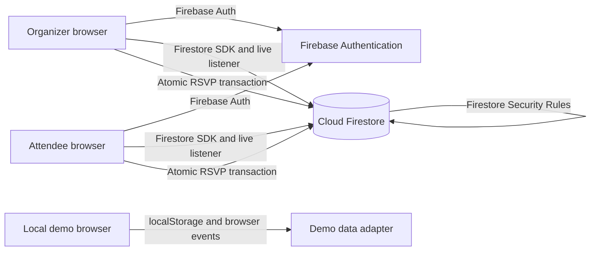

# Real-Time Cloud-Based Event Planning and RSVP Tracker

## Abstract

Gather is a cloud event planning and RSVP application designed for student clubs, workshops, meetups, and small community events. Organizers publish events with a capacity and RSVP deadline. Attendees respond with Going, Maybe, or Not Going. Firebase Authentication identifies each account, Cloud Firestore stores the event and response records, and Firestore listeners refresh connected screens when records change.

The project also has a local demo mode so the interface can be explored without a Firebase project. Local data is stored in the current browser and is not shared between devices.

## Problem statement

Small event teams often coordinate attendance in spreadsheets and group chats. Duplicate responses, stale counts, and manual capacity checks make it difficult to know how many people are coming. Gather centralizes event details and responses and updates RSVP counts as changes arrive.

## Objectives

- Provide separate organizer and attendee workflows.
- Store events and RSVP records in a shared cloud database.
- Prevent duplicate responses by assigning one RSVP document to each user for each event.
- Enforce event capacity with an atomic database transaction and security rules.
- Show event categories, current RSVP totals, and capacity use.
- Keep a local browser demo available for development and classroom walkthroughs.

## Architecture

The Firebase path uses the Firebase Web SDK directly. Authentication establishes the signed-in identity. The Firestore listener provides pushed updates to connected clients. An RSVP transaction reads the current event and the user's RSVP, checks capacity and the registration deadline, then updates the RSVP and event counters as one operation. Firestore Rules independently validate account ownership, organizer permissions, RSVP status transitions, and counter changes.

## Data model

| Collection | Purpose | Key fields |
| --- | --- | --- |
| `users/{userId}` | Account profile and role | `displayName`, `email`, `role` |
| `events/{eventId}` | Event and live summary | `createdBy`, `title`, `category`, `date`, `venue`, `capacity`, `counts`, `status` |
| `events/{eventId}/rsvps/{userId}` | One response per user and event | `userId`, `status`, `respondedAt`, `updatedAt` |
| `events/{eventId}/activity/{changeId}` | RSVP history for live growth chart | `userId`, `previousStatus`, `status`, `createdAt` |
| `events/{eventId}/announcements/{announcementId}` | Organizer update history | `title`, `message`, `createdBy`, `createdAt` |
| `events/{eventId}/invites/{token}` | One-time RSVP links and QR invitations | `name`, `email`, `status`, `acceptedBy`, `checkedInAt` |
| `events/{eventId}/checkins/{userId}` | One check-in record per attendee | `userId`, `inviteToken`, `checkedInBy`, `checkedInAt` |
| `users/{userId}/notifications/{notificationId}` | RSVP and announcement inbox | `eventId`, `type`, `message`, `read`, `createdAt` |

The RSVP document ID is the authenticated user's ID. This gives the `(eventId, userId)` pair a stable unique key. The event stores small aggregate counts for a fast dashboard; the transaction and security rules keep those counts consistent with a single RSVP change.

## Roles and access

- **Organizer:** creates, edits, and cancels their own events; posts announcements; sees RSVP analytics and checked-in totals.
- **Attendee:** browses events; responds Going, Maybe, or Not Going; sees their own response; checks themself in after a Going RSVP.

For this classroom project, sign-up allows the user to choose the Organizer role. Firestore Rules prevent users from changing their role later and prevent organizers from editing other organizers' events. A public production product should assign organizer privileges through an administrator or a trusted backend.

## Cloud computing concepts demonstrated

- **SaaS:** users access the event application through a browser.
- **PaaS/serverless data services:** Firebase hosts managed authentication and Firestore without a server maintained by the student.
- **Authentication and authorization:** Firebase Auth identifies users; Firestore Rules apply role and ownership checks.
- **Real-time data:** Firestore snapshot listeners refresh the category dashboards and RSVP totals.
- **Transaction processing:** the RSVP write and capacity counter change commit together or not at all.
- **Concurrency control:** concurrent final-seat attempts contend on the event document and are re-evaluated before commit.
- **Scalability boundary:** the aggregate counter is appropriate for a classroom or small event MVP. A very high traffic event would need a different counter and write-sharding strategy.
- **Environment configuration:** Firebase Web App settings are kept in `.env`, which is excluded from Git. Firebase Web configuration is public client configuration; database access is protected by Rules.

## Features in the current build

- Email/password account registration and sign-in
- Organizer and attendee views
- Create, edit, and cancel cloud events
- Community, Technology, Networking, Workshop, Social, Other, and All Events category dashboards
- Category counts; organizer-only RSVP distribution and capacity-use indicators
- RSVP growth chart and invitation/response/check-in totals for organizers
- Unique guest invitation links and QR codes, CSV import, and invitation-only RSVP option
- Attendee self check-in tied to the signed-in account and Going RSVP
- RSVP growth chart from RSVP change history
- Search within the selected category
- RSVP status changes, one per signed-in attendee
- Real-time RSVP counts and current-user response state
- Capacity and deadline checks
- FIFO waitlist queue with automatic promotion by the organizer dashboard when a place opens
- Organizer announcements
- Announcement history and in-app notifications for RSVP changes and event announcements
- In-app reminder notification for Going/Maybe attendees during the 24 hours before an event when they have the app open
- Local demo fallback
- Firebase Hosting configuration and Firestore Rules
- Local unit tests for RSVP status and capacity logic

## Features intentionally excluded from this no-billing version

Cloud email, SMS, and push delivery; scheduled cloud jobs; managed Firestore backups; and AI inference on Cloud Run can introduce billing requirements or require a paid external provider. This version does not enable them. Organizer announcements are visible inside the app, and RSVP confirmations are shown in the active session.

GitHub Actions CI runs the unit tests and production build on pushes and pull requests. This no-billing version uses the Firebase Web SDK directly with Firestore Rules; it does not provide the custom `/api/...` REST server described in the brief. The Firebase Auth and Firestore REST API mapping is documented in [docs/REST_API_DESIGN.md](docs/REST_API_DESIGN.md). Email, SMS, push delivery, scheduled background reminders, managed backups, and hosted AI inference are excluded because they require billing-enabled cloud services or an external provider. An in-app reminder is generated only while an attendee has the app open within 24 hours of an event. The waitlist runs through the signed-in organizer dashboard; it does not promote while the organizer is offline. Full multi-browser security/concurrency test coverage remains a deployment validation task. See [docs/BRIEF_COVERAGE.md](docs/BRIEF_COVERAGE.md) for the complete review and GitHub checklist.

## Run and deploy

See `README.md` for local setup, Firebase configuration, Firestore Rules deployment, and Firebase Hosting commands. `npm test` runs the local RSVP logic tests; `npm run build` creates the static deployment bundle.

## Conclusion

Gather demonstrates how managed cloud authentication and database services, real-time listeners, transactions, and security rules support event planning, invitations, RSVPs, waitlisting, notifications, analytics, and attendee self check-in. The REST backend, optional predictive model, billing-gated services, live deployment, and multi-user validation are not complete; see the coverage audit before claiming full compliance with the supplied brief.
